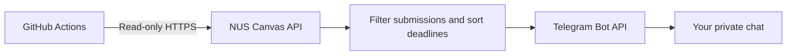

<div align="center">
  <h1>🎓 NUS Canvas → Telegram</h1>
  <h3>Your deadlines, delivered before your day begins.</h3>
  <p><strong>A free, open-source, personal deadline reminder for National University of Singapore students.</strong></p>
  <p>
    <a href="https://www.python.org/"></a>
    <a href="https://docs.github.com/en/actions"></a>
    <a href="LICENSE"></a>
    <a href="#disclaimer"></a>
  </p>
  <p><strong>No server · No database · No monthly hosting subscription · No sharing credentials with a project operator</strong></p>
</div>

---

## ✨ What you'll get

At **8:00 AM SGT** every day (subject to GitHub's scheduling delays), receive a message in **your own Telegram chat** with incomplete Canvas work due within the next **7 days**.

### 📱 Example Telegram reminder

> 📅 **NUS Canvas daily digest** · Mon, 12 Oct 2026 (SGT)
>
> 🔴 **Due within 48 hours**
>
> • [Assignment] CS2100 — Tutorial 7  
> &nbsp;&nbsp;Due: Mon 12 Oct, 11:59 PM SGT
>
> • [Quiz] CS2106 — Quiz 5  
> &nbsp;&nbsp;Due: Tue 13 Oct, 6:00 PM SGT
>
> 🟠 **Later within 7 days**
>
> • [Assignment] CS2102 — Assignment 3  
> &nbsp;&nbsp;Due: Fri 16 Oct, 11:59 PM SGT
>
> *Updates daily; check Canvas for authoritative deadlines.*

*Example data only. Actual messages link directly to your Canvas items.*

| What you get | What stays simple |
|:---|:---|
| ✅ Assignments and supported quizzes | 🔒 Your own GitHub Actions secrets |
| 🔴 Urgent deadlines highlighted | 🇸🇬 Singapore time by default |
| ✅ Submitted work filtered when Canvas confirms completion | 🔗 One-click Canvas assignment links |
| 🧪 Tested on every pull request | 💸 No paid server required |

## 🚀 Quick start (about 5–10 minutes)

> [!IMPORTANT]
> **Create your own copy using “Use this template” → “Create a new repository” → “Private”.**
> **Do not send your Canvas token to the maintainers, Telegram strangers, or GitHub issues.**
>
> This is a *self-deployment template*, **not** a public bot that logs you in. Each student runs their own GitHub Actions workflow.

### 1 · Make your own private copy

Click **Use this template** above the repository file list. Choose **Create a new repository**, make it **Private**, and give it any name you like.

If that button is not shown, the maintainer still needs to enable **Settings → General → Template repository**. You can download the code and push it into a fresh private repository instead.

**Why not Fork?** GitHub disables scheduled workflows on public forks by default, and a template creates a clean history. A generated private repository also lets you keep your own settings out of the public eye.

### 2 · Create a Telegram bot and find your chat ID

1. In Telegram, message [@BotFather](https://t.me/BotFather), send `/newbot`, and follow its prompts. **Keep the bot token secret.**
2. Open your **new bot**, press **Start**, and send `/start`.
3. On your computer, clone **your own new repository**, open a terminal in that directory, and run:

   ```bash
   python3 -m venv .venv
   source .venv/bin/activate
   python -m pip install -r requirements.txt
   python tools/get_chat_id.py
   ```

   *Windows PowerShell users: activate with `.venv\Scripts\Activate.ps1` instead of `source .venv/bin/activate`.*

4. When prompted, paste the BotFather token into the **hidden terminal prompt**. Copy the printed **numeric private chat ID**.

The helper makes one API request to Telegram; you do not need to host any Telegram polling server. If no chat ID appears, send your bot another message and retry.

### 3 · Generate your own NUS Canvas token

1. Go directly to [NUS Canvas](https://canvas.nus.edu.sg/profile/settings) and sign in normally.
2. Open **Account → Settings → Approved Integrations → + New Access Token** (if this option is enabled on your account).
3. Set a descriptive purpose, for example `Personal Telegram reminders`, and a **short expiry date**.
4. Copy the token; Canvas may only show it once.

> [!CAUTION]
> Canvas tokens give access to your account through the API. Do **not** share them with the repository maintainers, commit them to Git, or paste them into Telegram. Read the [security notes](SECURITY.md) before continuing.

### 4 · Add your three GitHub Actions secrets

In **your private repository** go to **Settings → Secrets and variables → Actions → New repository secret** and create:

| Name | Value |
|:---|:---|
| `CANVAS_TOKEN` | Your personal Canvas API token from step 3 |
| `TELEGRAM_BOT_TOKEN` | Your BotFather bot token from step 2 |
| `TELEGRAM_CHAT_ID` | The numeric private chat ID from step 2 |

Paste values only into the **GitHub Actions secrets** form. Never into `README.md`, `.env`, source files, issue reports, or workflow YAML.

### 5 · Send a test reminder 🎉

1. Open the **Actions** tab in your private repository and enable workflows if GitHub asks you to.
2. Select **Daily NUS deadline reminder**.
3. Click **Run workflow → Run workflow**.
4. Wait for the green `digest` job and check your Telegram chat. Even if nothing is due, you will receive an “all clear” digest on successful execution.

That's it! Your computer can be switched off. The scheduled workflow runs on GitHub-hosted runners daily.

---

## 🧠 How it works



The script runs once, sends a digest, and exits. There is **no hosted project backend**, no per-student user database, and no credential collection by the maintainer. Your personal GitHub Actions runtime processes your token when the workflow executes; your deadline text is delivered through Telegram.

**Scope and limitations:** uses Canvas assignment submissions and supported Classic Quiz submissions; Canvas New Quizzes may appear as assignments. Some courses restrict quiz endpoints, and missing optional quiz endpoints are skipped with warnings. Offline/paper assignments, unusual submissions, and per-user Classic Quiz override dates may not be reflected. **Always verify high-stakes deadlines in Canvas.**

### Customization (optional)

In your own repository, go to **Settings → Secrets and variables → Actions → Variables**. Add non-secret configuration variables:

| Variable | Default | Meaning |
|:---|---:|:---|
| `REMINDER_DAYS` | `7` | Look ahead 1–30 days |
| `URGENT_HOURS` | `48` | Highlight items due in 1–168 hours |

**To change the send time**, edit `.github/workflows/daily-reminder.yml`:

```yaml
on:
  schedule:
    - cron: '0 0 * * *' # 00:00 UTC = 08:00 Singapore time
```

GitHub schedules may run late or occasionally be skipped. This is a daily planning digest, **not a guaranteed last-minute alarm**. The cron time is in UTC; Singapore is UTC+8 all year.

### Cost

Normally **$0**: GitHub-hosted Actions minutes for a tiny daily script are typically within the free allowances. Public repositories generally have free standard runners; private repositories have included minutes subject to your GitHub plan. Check [GitHub Actions billing](https://docs.github.com/en/billing/concepts/product-billing/github-actions) for current limits.

---

## 🔧 Troubleshooting

<details>
<summary><strong>Nothing appeared in Telegram</strong></summary>

- Make sure you sent `/start` to **your** bot and copied the private chat ID, not the bot username.
- Open **Actions → the latest run → digest → Send personal Telegram digest**.
- HTTP 400 usually indicates a chat ID problem. HTTP 401 from Telegram indicates the bot token is invalid.
- A successful workflow sends an empty digest even when there are no deadlines.

</details>

<details>
<summary><strong>Canvas says HTTP 401, 403, or 404</strong></summary>

- **401:** Access token invalid or expired; regenerate it in Canvas and replace your secret.
- **403:** Your Canvas account may not have permission for a required course endpoint.
- **404:** Check the safe API endpoint path in your Actions logs. Optional Classic Quiz listing endpoints may be skipped automatically (with a warning); required assignments or course endpoints still fail.
- Some school/course content is simply unavailable through supported Canvas API endpoints; this tool cannot fix school-side permissions.

</details>

<details>
<summary><strong>Workflow hasn't run every morning</strong></summary>

- Confirm **Actions** is enabled, all three secrets are present, and the workflow is on `main`.
- GitHub scheduled jobs can be delayed or sometimes skipped under load.
- On **public forks**, scheduled workflows are disabled by default. Prefer **Use this template**.
- Inactive **public** repositories can have scheduled workflows disabled after 60 days without activity; if yours is public, re-enable it in Actions as needed. Private generated copies avoid this public-repository rule.

</details>

<details>
<summary><strong>My Canvas token has expired / I want to stop</strong></summary>

To renew, generate a new token in Canvas and replace `CANVAS_TOKEN` under your repository's Actions secrets. **Revoke** the old token through Canvas Settings.

To stop reminders, choose **Actions → Daily NUS deadline reminder → ··· → Disable workflow**, then revoke the token if no longer needed.

</details>

## 🛡️ Privacy and security

- **Personal use only:** Every student creates their own copy. There is no shared token collection, central bot, or student database.
- **Strict Canvas origin:** API access uses HTTPS to `canvas.nus.edu.sg` and refuses credential-bearing redirects to other hosts.
- **Minimum GitHub permissions:** workflows request `contents: read`; PR tests run **without any secrets**.
- **Safe logs:** no credential values or Canvas response bodies are printed intentionally.
- **Review dependencies and collaborators:** anyone who can edit your scheduled workflow may be able to exfiltrate Actions secrets at run time.
- **Transmission:** Telegram receives course names and deadlines; Telegram bot chats are not end-to-end encrypted.

See [SECURITY.md](SECURITY.md) for vulnerability reporting and token revocation.

## 🤝 Contributing

Bug fixes and suggestions from NUS students are welcome. See [CONTRIBUTING.md](CONTRIBUTING.md). Unit tests can run locally without credentials:

```bash
python -m pip install -r requirements.txt
python -m unittest discover -s tests -v
```

The repository also runs the same tests automatically on pull requests. Never include real tokens or personal student data in a PR.

## 📄 License

Released under the **[MIT License](LICENSE)** — you can use, modify, and share this code while retaining the copyright/license notice.

> **Acknowledgement:** The idea of personal NUS Canvas/Telegram integration was informed by [lavanyagarg112/nus-assistant-bot](https://github.com/lavanyagarg112/nus-assistant-bot). The implementation here was written independently; no code was copied from that repository, which did not have a stated open-source license when examined.

### Disclaimer

This is an **unofficial, student-built tool**. It is **not developed, approved, or endorsed by NUS, Instructure, Canvas, Telegram, or GitHub**. Use only your own API token and comply with applicable university and Canvas policies. The source is offered *as is*, without guaranteed delivery or assignment accuracy.

<div align="center">

**Built to spend less time checking deadlines, and more time getting things done.** 💛

</div>
