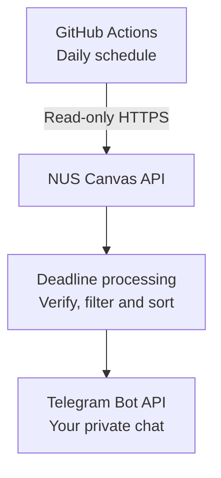

<div align="center">

<h1>🎓 NUS Canvas → Telegram</h1>
<p><strong>Your deadlines, delivered before your day begins.</strong></p>
<p>A free, personal, serverless deadline reminder for NUS students.<br />
Run your own private copy with GitHub Actions and your own Telegram bot.</p>

<p>
  <a href="https://www.python.org/downloads/"></a>
  <a href="LICENSE"></a>
  <a href="https://github.com/Brendan-Lim/NUS-Canvas-Daily-Telegram-Reminder-Bot/actions/workflows/tests.yml"></a>
</p>

<p>
  <strong><a href="https://github.com/Brendan-Lim/NUS-Canvas-Daily-Telegram-Reminder-Bot/generate">Use this template →</a></strong>
  &nbsp;·&nbsp;
  <a href="#quick-start">Quick Start</a>
</p>

</div>

## What you get

| At a glance | How it works |
| :--- | :--- |
| **08:00 SGT daily** | A morning digest, subject to GitHub scheduling delays. |
| **Seven days ahead** | Upcoming incomplete work, sorted by deadline. |
| **48-hour urgency** | Near-term deadlines highlighted in your digest. |
| **Automatic Telegram pairing** | Verify your private chat; no manual Chat ID lookup. |
| **Your personal credentials** | Stored in your own repository's GitHub Actions secrets. |
| **No server or database** | A one-shot workflow; your computer can be switched off. |

Each student runs a private deployment. There is no central user registry or credential collection by the maintainer. Canvas remains the authoritative source for deadlines and submission status.

## A look at the daily digest

> 📅 **NUS Canvas daily digest**\
> Mon, 12 Oct 2026 (SGT)
>
> 🔴 **Due within 48 hours**
>
> • [Assignment] **CS2100 — Tutorial 7**\
> Due: Mon 12 Oct, 11:59 PM SGT
>
> • [Quiz] **CS2106 — Quiz 5**\
> Due: Tue 13 Oct, 6:00 PM SGT
>
> 🟠 **Later within 7 days**
>
> • [Assignment] **CS2102 — Assignment 3**\
> Due: Fri 16 Oct, 11:59 PM SGT
>
> *Updates daily; check Canvas for the authoritative deadlines.*

*Fictional example. Your reminders link directly to the Canvas items.*

## Quick Start

You need a GitHub account, Telegram, and a computer with [Python 3.12 or newer](https://www.python.org/downloads/), [Git](https://git-scm.com/downloads), and [GitHub CLI (`gh`)](https://cli.github.com/). Install these before step 4. Setup runs locally once; the daily reminder then runs on GitHub.

> [!IMPORTANT]
> Use **your own private repository and credentials**. Never put API tokens in Telegram, issues, source files, workflow YAML, or messages to maintainers.

### 1. Make your private copy

Choose **[Use this template](https://github.com/Brendan-Lim/NUS-Canvas-Daily-Telegram-Reminder-Bot/generate) → Create a new repository**. Select **Private**, give it a name, and create it. Use a template rather than a public fork.

### 2. Create your Telegram bot

Message [@BotFather](https://t.me/BotFather), send `/newbot`, and follow the prompts. Keep the **bot token** for the hidden setup prompt. Use a new dedicated bot, without a webhook or another polling application.

### 3. Get your Canvas token

Sign in to [NUS Canvas settings](https://canvas.nus.edu.sg/profile/settings). Open **Account → Settings → Approved Integrations → + New Access Token**, if available for your account. Set a purpose such as `Personal deadline reminders` and a short expiry, then copy the token.

A Canvas token can access your account. Keep it private and read the [security notes](SECURITY.md) before continuing.

### 4. Run setup and pair your chat

Open **Terminal** on macOS/Linux or **PowerShell** on Windows. Sign in to your own GitHub account using the browser flow:

```text
gh auth login --hostname github.com --web --git-protocol https
```

Replace `YOUR-NAME/YOUR-REPO` with **your private copy**, then clone it and open its folder:

```text
gh repo clone YOUR-NAME/YOUR-REPO
cd YOUR-REPO
```

Run the commands for your computer:

<details>
<summary><strong>macOS and Linux</strong></summary>

```bash
python3 --version # must be 3.12 or newer
python3 -m venv .venv
.venv/bin/python -m pip install --only-binary=:all: --require-hashes -r requirements.txt
.venv/bin/python tools/setup_telegram.py --repo YOUR-NAME/YOUR-REPO
```

</details>

<details>
<summary><strong>Windows PowerShell</strong></summary>

```powershell
py -3.12 -m venv .venv
.\.venv\Scripts\python.exe -m pip install --only-binary=:all: --require-hashes -r requirements.txt
.\.venv\Scripts\python.exe tools/setup_telegram.py --repo YOUR-NAME/YOUR-REPO
```

</details>

Paste your Canvas and bot tokens into the **hidden terminal prompts**. The wizard checks that your repository is private and you have administration permission. Open the bot link it shows, then send its exact command in **your bot's private Telegram chat** while setup waits:

```text
/start <pairing-code-shown-by-the-wizard>
```

The random code expires after **five minutes**. Keep it private: it authorizes the reminder destination. Send the pairing code only, never either API token. The wizard discovers your Chat ID and saves all three Actions secrets automatically.

### 5. Send a test reminder

In your private repository, open **Actions → Daily NUS deadline reminder → Run workflow**. Enable Actions if prompted, then check the run result and your Telegram chat.

A complete scan sends a digest even if nothing is due. Partial and failed scans warn you to check Canvas and fail the workflow; Telegram delivery failures also fail it. Your computer can now be switched off.

<details>
<summary><strong>What setup saves, and how pairing protects your chat</strong></summary>

| Actions secret | Stored value |
| :--- | :--- |
| `CANVAS_TOKEN` | Your personal Canvas API token. |
| `TELEGRAM_BOT_TOKEN` | Your BotFather bot token. |
| `TELEGRAM_CHAT_ID` | Your automatically verified private chat destination. |

Setup uses your authenticated local GitHub CLI session with permission to manage repository Actions secrets. You do not need to create a separate personal access token. The default workflow `GITHUB_TOKEN` cannot perform this setup.

Tokens stay in process memory and go to `gh` through stdin, not command arguments or tracked files. The wizard briefly polls Telegram and exits; it does not depend on old retained messages. Only a correctly paired private user is accepted. Multiple users presenting the code in received updates cause pairing to fail. Anyone who learns the code before pairing finishes could claim the destination; start again if it is exposed.

Secret updates are not atomic. If provisioning fails partway, rerun setup to replace all three consistently. Setup never deletes a webhook automatically.

**Already configured?** Your existing three secrets remain compatible. Pair again only when changing your bot or destination. The old `tools/get_chat_id.py` helper points to secure setup.

</details>

## How it works



The script runs once, checks supported deadlines, sends a digest, and exits. There is no hosted project backend, always-on polling server, database, or paid hosting dependency.

## Coverage and scan results

| Canvas activity | What is supported |
| :--- | :--- |
| **Assignments** | Active student courses, submission data, and student-specific assignment date overrides. |
| **Classic Quizzes** | Available quiz endpoints; linked assignment records prevent duplicates and generic-date fallback. Standalone quizzes use the current-user submission endpoint. |
| **New Quizzes** | Canvas assignment records, labelled as quizzes when Canvas identifies them. |

Standalone Classic Quiz dates may not resolve individual overrides. Reported override information triggers a partial warning; verify these quizzes in Canvas. This project does not detect every Canvas activity type.

<details>
<summary><strong>Submission filtering and activities outside the supported scope</strong></summary>

- Current `unsubmitted` states and instructor reassignment (`redo_request`) remain incomplete even with previous attempts, grades, or timestamps.
- Submitted and pending-review states confirm submission. Graded submissions require actual submission evidence; a grade or attempt count alone is insufficient. Excused work is excluded separately.
- Missing or malformed submission information is **unknown**, not confirmed incomplete. A known deadline is retained with “submission unverified.” A null due date has no deadline; missing or invalid dates are never invented.
- Paper, external-tool, discussion, and other assignments can appear when Canvas exposes a due date, but completion information may be unavailable.
- Modules, announcements, peer-review tasks, calendar-only events, and third-party activities are not comprehensively covered.
- Unpublished records are excluded. Locked but published work can still have an upcoming deadline.

</details>

| Scan result | What your reminder means |
| :--- | :--- |
| **COMPLETE** | Required supported API information was checked. An empty digest is allowed; activities outside this scope may still be missed. |
| **PARTIAL** | Some courses, dates, or submission states could not be verified. Available results include a warning, and the workflow fails. An empty partial result is **not an all clear**. |
| **FAILED** | No useful information could be checked reliably, authentication failed, or unsafe API behavior was detected. A short failure warning is attempted, and the workflow fails even if it arrives. |

**Check Canvas directly when a warning appears or reminders stop.** Manual reruns may resend messages. A multi-message digest can be partly delivered before a failure; there is no exactly-once delivery guarantee or deduplication database.

<details>
<summary><strong>API resilience and Telegram delivery limits</strong></summary>

Authorization errors are not interpreted as empty courses. Course-local failures allow independent courses to continue. Invalid credentials, redirects, unsafe pagination, loops, and excessive pagination fail closed.

GET requests retry up to three attempts for transient network failures, HTTP 429, and HTTP 500/502/503/504. Backoff and reasonable `Retry-After` values are bounded. Requests retain timeouts; the Canvas scan has a five-minute request budget and the Actions job a ten-minute timeout.

Messages use escaped Telegram HTML and split within a conservative 4096-character bound. Sends are not automatically retried because a timeout can happen after delivery. Telegram failures produce safe diagnostics and a nonzero exit code; delivery is never claimed when unconfirmed.

</details>

## Schedule, settings and cost

The daily schedule stays at **08:00 SGT**:

```yaml
- cron: '0 0 * * *' # 00:00 UTC = 08:00 SGT
```

GitHub schedules can be **delayed or skipped**, especially near the start of an hour. A non-zero minute is an optional reliability trade-off in your own copy; this project keeps 08:00. Scheduled workflows use the default branch. Public forks need scheduling enabled, and inactive public repositories can have schedules disabled after 60 days. See [GitHub's schedule documentation](https://docs.github.com/en/actions/reference/workflows-and-actions/events-that-trigger-workflows#schedule).

Optional **Settings → Secrets and variables → Actions → Variables**:

| Variable | Default | Allowed range |
| :--- | :--- | :--- |
| `REMINDER_DAYS` | `7` | 1–30 days |
| `URGENT_HOURS` | `48` | 1–168 hours |

No paid server is required. Your private repository uses your plan's included GitHub-hosted Actions minutes. CI, dependency updates, and manual reruns also count. Beyond the allowance, billing settings may cause charges or stop runs. Check [Actions billing](https://docs.github.com/en/billing/concepts/product-billing/github-actions) and your account's usage and budgets; free usage is not unlimited.

## Privacy and your tokens

Telegram receives course names, activity titles, deadlines, and Canvas links. **Bot chats are not end-to-end encrypted.** GitHub processes credentials on its runners, and collaborators who can change your workflow could extract secrets. Keep your deployment private, review access and changes, and set short Canvas-token expiries. See [SECURITY.md](SECURITY.md).

- **Rotate Canvas credentials:** replace `CANVAS_TOKEN` in your private Actions secrets, then revoke the old token in **Canvas → Account → Settings → Approved Integrations**.
- **Rotate Telegram credentials:** revoke/regenerate an exposed token with **@BotFather**, then rerun setup.
- **Stop reminders:** disable **Daily NUS deadline reminder** in Actions and revoke unused tokens.

Removing a GitHub secret alone does not revoke the token at its provider. Never include tokens, student data, or private messages in bug reports.

## Troubleshooting

<details>
<summary><strong>Pairing expires, no updates arrive, or a webhook conflicts</strong></summary>

Rerun setup and send its **new exact command** to your bot while it waits. Stop other polling tools; old messages are not a setup mechanism.

For a webhook or HTTP 409 conflict, use a new dedicated bot or remove your own webhook/other polling tool. Setup never removes a webhook automatically.

</details>

<details>
<summary><strong>GitHub cannot save the setup secrets</strong></summary>

Run `gh auth login`, confirm your private repository name, and check that you have administration permission. Rerun setup after a partial secret update so all three values are consistent.

</details>

<details>
<summary><strong>Canvas fails, or the digest says “partial scan”</strong></summary>

- **HTTP 401:** generate a new personal Canvas token, replace `CANVAS_TOKEN`, and revoke the old token.
- **HTTP 403/404 or a partial warning:** check Canvas directly. Your institution or course may restrict endpoints; an unavailable endpoint is not an empty result.
- **HTTP 429 or a server error:** retries are bounded. Try a later manual run and check Canvas directly meanwhile.

</details>

<details>
<summary><strong>Nothing arrives in Telegram</strong></summary>

Open the latest Actions run and check its safe failure diagnostics.

- **HTTP 401/404:** check or rotate the bot token with BotFather and rerun setup.
- **HTTP 400/403:** make sure you have not blocked your bot; rerun pairing if the destination changed.
- If a digest failed midway, some messages may already have arrived. A manual rerun can resend them.

</details>

<details>
<summary><strong>The scheduled reminder did not run</strong></summary>

Check that Actions is enabled, the workflow is on your default branch, and all three secrets are present. Fully unconfigured scheduled runs skip; partial configuration and unconfigured manual runs fail.

Also check billing limits, public-fork restrictions, and inactive public-repository schedules. GitHub may delay or skip a scheduled run even when configuration is correct.

</details>

## Contributing

Bug fixes and practical improvements are welcome. Use fictional data in tests and reports. Read [CONTRIBUTING.md](CONTRIBUTING.md) for development and dependency updates, and [docs/PUBLISHING.md](docs/PUBLISHING.md) for release checks.

<details>
<summary><strong>Local validation commands</strong></summary>

With a virtual environment created as in Quick Start:

```bash
.venv/bin/python -m pip install --only-binary=:all: --require-hashes -r requirements-dev.txt
.venv/bin/python -m unittest discover -s tests -v
.venv/bin/python -m compileall -q reminder.py tools tests
.venv/bin/ruff check .
.venv/bin/ruff format --check .
.venv/bin/pip-audit --require-hashes --disable-pip -r requirements-dev.txt
.venv/bin/python tools/scan_secrets.py
```

On Windows use `.\.venv\Scripts\python.exe` and the corresponding executables instead. Runtime packages and transitives are hash-pinned; Dependabot proposes Python and action updates.

All tests use fictional data and mock network/CLI calls. They establish local behavior, **not live NUS Canvas or Telegram compatibility**. Verify your own account, endpoint permissions, pairing, secret provisioning, and delivery with a manual workflow run.

</details>

## Acknowledgements

Inspired in part by [nus-assistant-bot](https://github.com/lavanyagarg112/nus-assistant-bot). This project is an independently developed, serverless implementation focused on secure, self-hosted daily deadline reminders for NUS students.

## License and disclaimer

Released under the [MIT License](LICENSE). Retain its copyright and license notice when redistributing.

This is an **unofficial NUS student project**, not developed, approved, or endorsed by NUS, Instructure, Canvas, Telegram, or GitHub. Use only your own credentials and follow applicable university policies. Delivery and deadline accuracy are not guaranteed.
